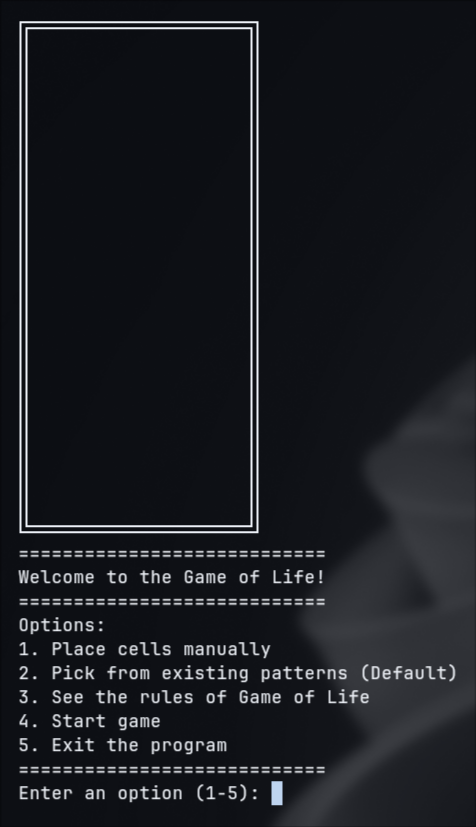
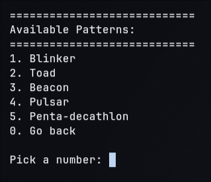

 # Game of Life

A fully playable terminal implementation of Conway's Game of Life built in Python.

## Description

Conway's Game of Life is a cellular automaton invented by John Conway. This implementation runs in the console with Unicode borders, allowing users to place cells and stamp patterns.

## Screenshots





## Getting Started

### Dependencies

Requires Python 3.10 or higher due to `match/case` syntax and works on Windows, macOS, and Linux.

### Installing

- Download the `main.py` file directly or grab the pre-compiled `.exe` from the Releases tab.

### Executing program

- Open a terminal.
- Navigate to the folder containing the program.
- Run:

```bash
python main.py
```

## Help

1. If the screen spams instead of clearing, replace `os.system("clear")` with `print("\033c", end="")`.
2. If a `SyntaxError` occurs on startup, check your Python version.

## License

This project is licensed under the MIT License - see the LICENSE.md file for details.
